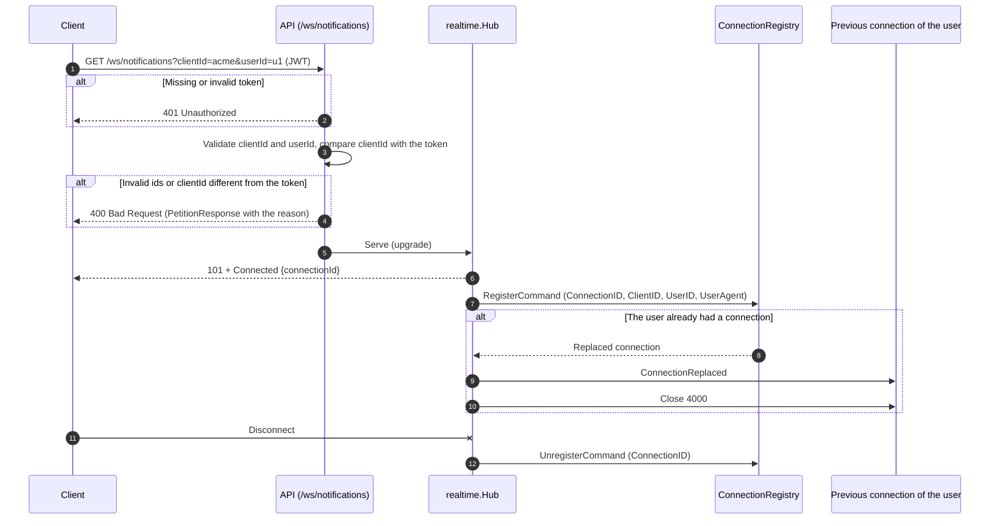
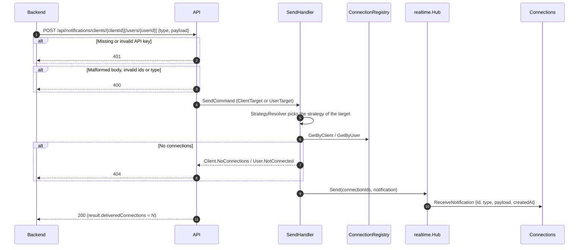
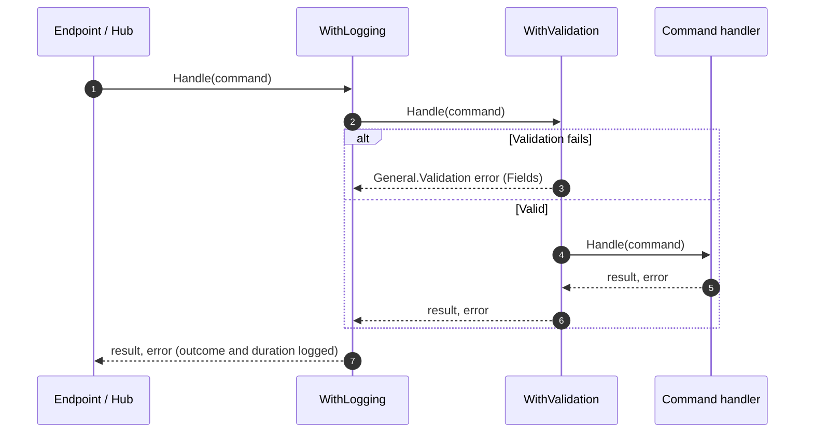

# notyhub-golang

Go service that acts as a **realtime notification hub**. Clients (web, mobile or services) open a **WebSocket** connection authenticated with a JWT and identified by
a **client id** and a **user id**, and backends push notifications through a REST API to **every connection of a
client** or to **the connection of one user**.

## Architecture

Clean Architecture, with dependencies pointing inwards:

```
notyhub-golang
├── cmd/notyhub/                  Entry point: config, logger, graceful shutdown, `healthcheck` subcommand
├── internal/
│   ├── domain/                   ClientID, UserID, ConnectionID, ClientConnection, Notification, Target,
│   │                             business errors (Error with Code, Description, Type, Fields)
│   ├── application/              Ports (ConnectionRegistry, NotificationDispatcher, Metrics, Clock),
│   │   │                         generic CommandHandler/QueryHandler + validation and logging decorators
│   │   ├── connections/          Register, Unregister, GetClientConnections
│   │   ├── notifications/        Send command + validator, delivery strategies and resolver
│   │   └── apptest/              Test doubles of the ports
│   ├── infrastructure/
│   │   ├── registry/             In-memory connection registry
│   │   ├── realtime/             WebSocket hub (also the dispatcher adapter), identity reader, wire messages
│   │   └── metrics/              Prometheus metrics (hub + HTTP + Go runtime)
│   ├── api/                      net/http routes, API key + JWT auth, PetitionResponse, middlewares,
│   │                             OpenAPI + Swagger UI (development)
│   ├── config/                   Configuration from environment variables, validated on start
│   └── app/                      Composition root and HTTP servers (+ end-to-end tests)
├── Dockerfile                    Multi-stage, distroless, non-root
├── docker-compose.yml
└── Makefile                      Go commands run inside Docker (no local toolchain needed)
```

Design patterns:

- **Ports and adapters**: the application layer defines `ConnectionRegistry`, `NotificationDispatcher` and
  `Metrics`; the infrastructure layer implements them.
- **Repository**: `ConnectionRegistry`, implemented by `registry.Memory` (indexes under one mutex).
- **Strategy + Factory**: `notifications.DeliveryStrategy` (client and user strategies), selected by
  `StrategyResolver` from the `domain.Target`.
- **Decorator**: `application.WithValidation` and `WithLogging` wrap every command handler (`Decorate`).
- **Lightweight CQRS**: generic `CommandHandler[C, R]` / `QueryHandler[Q, R]` interfaces.
- **Errors as values**: business errors are `*domain.Error` (validation failures in `Fields`), mapped to a
  `PetitionResponse` by the API.
- **Adapter**: `realtime.Hub` implements the dispatcher port over WebSocket connections.
- Configuration validated on start: `config.Load` reports every invalid value at once.

A new kind of target (group, broadcast, ...) is a new `domain.Target` plus a new strategy registered in the
resolver, without touching the send handler.

## Connection model

| Concept            | Description                                                                            |
|--------------------|----------------------------------------------------------------------------------------|
| `ClientID`         | Client (tenant or application) that owns the connections. Sent by the connection and checked against the JWT |
| `UserID`           | User within a client. Unique per client: the same user id in two clients is two users |
| `ConnectionID`     | Random UUID the hub generates for the connection                                       |
| `ClientConnection` | ConnectionID, ClientID, UserID, ConnectedAt, UserAgent                                 |

Rules for `clientId` and `userId`:

- Required, at most **128** characters.
- **No whitespace** anywhere (leading, trailing or inside); they are rejected, not trimmed.
- Letters are **normalized to lowercase**, so `ACME`/`U1` and `acme`/`u1` are the same ids. The REST routes apply
  the same normalization.

A client can have many users connected, and **each user has a single connection**: when a user opens a new
connection, it replaces the previous one, which receives `ConnectionReplaced` and is closed with code `4000`. The
user → connection relation is only removed while it still points to the closing connection, so the late disconnect
of a replaced connection does not affect its replacement.

## WebSocket hub

The hub is at `/ws/notifications` (`REALTIME_HUB_PATH`) and requires a JWT and the `clientId` and `userId` of the
connection in the query string:

```
ws://localhost:8080/ws/notifications?clientId=acme&userId=u1&access_token=<jwt>
```

Browsers cannot set headers on WebSocket requests, so the token goes in `access_token`; other clients may use
`Authorization: Bearer <jwt>`. The `clientId` must be the client id of the token (claim `REALTIME_CLIENT_ID_CLAIM`,
`sub`). Requests are validated **before** the upgrade, so the handshake fails with:

| Status | When                                                                                     |
|--------|------------------------------------------------------------------------------------------|
| `401`  | Missing or invalid token                                                                 |
| `400`  | `clientId` or `userId` missing, repeated, with whitespace or longer than 128 characters, or `clientId` different from the token |

The body is a `PetitionResponse` (module `ConnectionService` for `400`) whose `message` tells the reason.
Cross-origin browser connections are accepted only from `CORS_ALLOWED_ORIGINS`.

Every frame is a JSON text message `{ "event": "...", "data": ... }`:

| Direction       | Event                 | `data`                                       | Description                                         |
|-----------------|-----------------------|----------------------------------------------|-----------------------------------------------------|
| Server → client | `Connected`           | `{ connectionId }`                           | First frame after the connection opens              |
| Server → client | `ReceiveNotification` | `{ id, type, payload, createdAt }`           | A notification                                      |
| Server → client | `ConnectionReplaced`  | —                                            | The same user opened a new connection; this one closes next with code `4000` |
| Client → server | `GetConnectionId`     | —                                            | Asks for the id of the connection                   |
| Server → client | `ConnectionId`        | `{ connectionId }`                           | Answer to `GetConnectionId`                         |

The server pings every 15 seconds. A client that does not read fast enough (64 queued messages) is closed with
`1008`; on shutdown connections are closed with `1001`.

```js
function connect(token) {
  const ws = new WebSocket(`ws://localhost:8080/ws/notifications?clientId=acme&userId=u1&access_token=${token}`);

  ws.onmessage = ({ data }) => {
    const { event, data: body } = JSON.parse(data);
    if (event === "ReceiveNotification") console.log(body.type, body.payload);
    if (event === "ConnectionReplaced") console.log("Opened somewhere else");
  };

  // 4000: replaced by another connection of the same user, do not reconnect.
  ws.onclose = ({ code }) => { if (code !== 4000) setTimeout(() => connect(token), 2000); };
}
```

## Endpoints

Every `/api` endpoint requires the `X-Api-Key` header with one of the keys in `API_KEYS`.

| Method | Route                                          | Description                                                  |
|--------|------------------------------------------------|--------------------------------------------------------------|
| POST   | `/api/notifications/clients/{clientId}`        | Sends `{ type, payload }` to every connection of the client  |
| POST   | `/api/notifications/clients/{clientId}/users/{userId}` | Sends `{ type, payload }` to the connection of the user |
| GET    | `/api/clients/{clientId}/connections`          | Lists the active connections of the client                   |
| GET    | `/ws/notifications`                            | WebSocket hub (JWT)                                          |
| POST   | `/dev/token`                                   | Issues a client JWT for `{ clientId }` (development only)    |
| GET    | `/swagger`, `/openapi/v1.yaml`                 | Swagger UI and OpenAPI document (development only)           |
| GET    | `/health`                                      | Liveness check                                               |

`type` is required (up to 100 characters) and names the event, for example `order.updated`. `payload` is optional
and can be any JSON value; clients receive it as is (`null` when absent).

### Response format

Every response, successful or not, is a `PetitionResponse`, and its `statusCode` is also the HTTP status code:

```json
{
  "success": true,
  "message": "Notification sent successfully.",
  "module": "NotificationService",
  "result": {
    "notificationId": "019a3f0e-5c78-7f95-b34f-9617811e77f0",
    "deliveredConnections": 2,
    "sentAt": "2026-11-02T19:14:37.816359Z"
  },
  "statusCode": 200
}
```

| Property     | Description                                                                                   |
|--------------|-----------------------------------------------------------------------------------------------|
| `success`    | Whether the petition was processed successfully                                               |
| `message`    | Message describing the processing                                                             |
| `module`     | `NotificationService`, `ConnectionService`, `TokenService`, `RequestValidation` (malformed or missing body), `GlobalExceptionHandler` (unexpected errors), `HealthCheck` or `Api` (missing API key, unknown route, method or media type) |
| `result`     | Returned information, or `null`. On validation failures it holds `errors`, grouped by field  |
| `statusCode` | HTTP status code                                                                              |

| Endpoint                                   | `result`                                                              |
|--------------------------------------------|-----------------------------------------------------------------------|
| `POST /api/notifications/...`              | `{ notificationId, deliveredConnections, sentAt }`                    |
| `GET /api/clients/{clientId}/connections`  | `[{ connectionId, clientId, userId, connectedAt, userAgent }]`, oldest first (empty when none) |
| `POST /dev/token`                          | `{ accessToken, expiresAt }`                                          |
| `GET /health`                              | `{ status, checks }`                                                  |

A validation failure:

```json
{
  "success": false,
  "message": "One or more validation errors occurred.",
  "module": "NotificationService",
  "result": { "errors": { "Type": ["'Type' must not be empty."] } },
  "statusCode": 400
}
```

Status codes: `200` success, `400` validation (invalid route value, body field, or a malformed or missing body),
`401` missing or invalid API key, `404` the client has no active connections (`Client.NoConnections`) or the user is
not connected (`User.NotConnected`), `405`/`415` unsupported method or media type, `500` unexpected error.

## Sequence diagrams

### Connection lifecycle



### Send to a client or a user



### Command pipeline



## Health checks

`GET /health` answers `200` with a `PetitionResponse` (module `HealthCheck`). The runtime image has no shell or curl,
so the Docker healthcheck runs `/notyhub healthcheck`, which calls `/health` on the local API address. Health
requests are excluded from the HTTP metrics.

## Metrics

Prometheus metrics are served at `GET /metrics` **only on a dedicated address** (`METRICS_ADDR`) that is not
published, so Prometheus scrapes it from the private network. It runs as a separate HTTP server, so `/metrics` is
never reachable through the public port, whatever the `Host` header.

| Port   | Serves                                   | Exposure                                         |
|--------|------------------------------------------|--------------------------------------------------|
| `8080` | API, hub and `/health`                   | Public                                           |
| `9464` | `/metrics` only (anything else is `404`) | Internal: `expose` in Docker, never `ports`      |

In development the metrics address defaults to `:9465`.

| Prometheus metric                                     | Type      | Labels              | Description                                                   |
|-------------------------------------------------------|-----------|---------------------|---------------------------------------------------------------|
| `notyhub_connections_active`                       | Gauge     |                     | Connections currently registered                              |
| `notyhub_clients_active`                           | Gauge     |                     | Clients with at least one connection                          |
| `notyhub_connections_opened_total`                 | Counter   |                     | Connections registered                                        |
| `notyhub_connections_closed_total`                 | Counter   |                     | Connections removed when they closed                          |
| `notyhub_connections_replaced_total`               | Counter   |                     | Connections replaced by a new connection of the same user     |
| `notyhub_notifications_sent_total`                 | Counter   | `target`, `outcome` | `target`: `client`/`user`, `outcome`: `delivered`/`not_found` |
| `notyhub_notifications_recipients_total`           | Counter   | `target`            | Connections notifications were delivered to                   |
| `notyhub_notifications_dispatch_duration_seconds`  | Histogram | `target`            | Time the hub took to dispatch a notification                  |
| `http_server_request_duration_seconds`                | Histogram | `http_route`, `http_request_method`, `http_response_status_code` | HTTP requests (WebSocket requests last as long as the connection) |
| `http_server_active_requests`                         | Gauge     |                     | Requests in progress                                          |
| `go_*`, `process_*`                                   |           |                     | Go runtime (GC, goroutines, memory) and process (CPU, memory, file descriptors) |
| `target_info{service_name="notyhub"}`              | Gauge     |                     | Service metadata                                              |

`opened = closed + replaced + active`; the active gauges read the registry on each scrape, so they cannot drift.

```yaml
scrape_configs:
  - job_name: notyhub
    scrape_interval: 15s
    static_configs:
      - targets: ["notyhub:9464"]
```

| Panel                          | PromQL                                                                                                   |
|--------------------------------|----------------------------------------------------------------------------------------------------------|
| Active connections / clients   | `notyhub_connections_active`, `notyhub_clients_active`                                             |
| Notifications per second       | `sum by (target, outcome) (rate(notyhub_notifications_sent_total[5m]))`                               |
| Dispatch latency p95           | `histogram_quantile(0.95, sum by (le, target) (rate(notyhub_notifications_dispatch_duration_seconds_bucket[5m])))` |
| HTTP latency p95 by route      | `histogram_quantile(0.95, sum by (le, http_route) (rate(http_server_request_duration_seconds_bucket{http_route!="/ws/notifications"}[5m])))` |
| Memory / goroutines            | `process_resident_memory_bytes`, `go_goroutines`                                                         |

## Running

Go runs inside Docker/Podman through the `Makefile`, so no local Go toolchain is needed.

```bash
make run
```

Starts the hub in development on `http://localhost:8080` (Swagger UI at `/swagger`, metrics at
`http://localhost:9465/metrics`, API key `dev-api-key-change-me`). Issue a client token:

```bash
curl -X POST http://localhost:8080/dev/token -H "Content-Type: application/json" -d '{"clientId":"client-1"}'
```

Connect with any WebSocket client, for example [websocat](https://github.com/vi/websocat):

```bash
websocat "ws://localhost:8080/ws/notifications?clientId=client-1&userId=u1&access_token=<token>"
```

Send a notification:

```bash
curl -X POST http://localhost:8080/api/notifications/clients/client-1 \
  -H "X-Api-Key: dev-api-key-change-me" -H "Content-Type: application/json" \
  -d '{"type":"order.updated","payload":{"orderId":7}}'
```

### Docker

```bash
docker compose up -d --build
```

The container runs in production, so Swagger UI and `/dev/token` are disabled; set `APP_ENV=development` to enable
them.

| Variable            | Default                                         | Setting           |
|---------------------|-------------------------------------------------|-------------------|
| `JWT_SIGNING_KEY`   | `local-docker-signing-key-change-me-0123456789` | `JWT_SIGNING_KEY` |
| `PUBLISHER_API_KEY` | `docker-api-key-change-me`                      | `API_KEYS`        |
| `APP_ENV`           | `production`                                    | Environment       |

The defaults are only meant for local runs; replace them in any shared environment.

## Configuration

Environment variables (see `.env.example`). The hub does not start when a value is missing or invalid, and it
reports every invalid value at once.

| Variable                   | Default                         | Description                                                    |
|----------------------------|---------------------------------|----------------------------------------------------------------|
| `APP_ENV`                  | `production`                    | `production` or `development` (Swagger, `/dev/token`, local defaults, text logs) |
| `LOG_LEVEL`                | `info`                          | `debug`, `info`, `warn`, `error`                               |
| `HTTP_ADDR`                | `:8080`                         | Public address                                                 |
| `METRICS_ADDR`             | `:9464` (`:9465` in development)| Internal metrics address; must differ from `HTTP_ADDR`         |
| `METRICS_PATH`             | `/metrics`                      | Scraping path                                                  |
| `JWT_ISSUER`               | `notyhub`                    | Expected `iss`                                                 |
| `JWT_AUDIENCE`             | `notyhub-clients`            | Expected `aud`                                                 |
| `JWT_SIGNING_KEY`          | — (development key in dev)      | HMAC-SHA256 key, at least 32 characters                        |
| `API_KEY_HEADER`           | `X-Api-Key`                     | Header of the backend keys                                     |
| `API_KEYS`                 | — (`dev-api-key-change-me` in dev) | Comma-separated keys; compared in constant time             |
| `CORS_ALLOWED_ORIGINS`     | — (`localhost:3000`, `localhost:5173` in dev) | Comma-separated browser origins                  |
| `REALTIME_HUB_PATH`        | `/ws/notifications`             | Route of the hub                                               |
| `REALTIME_CLIENT_ID_CLAIM` | `sub`                           | JWT claim that holds the client id                             |
| `REALTIME_CLIENT_ID_QUERY` | `clientId`                      | Query parameter with the client id                             |
| `REALTIME_USER_ID_QUERY`   | `userId`                        | Query parameter with the user id                               |

Tokens must be HS256 with `exp`; a clock skew of 30 seconds is allowed.

## Scaling out

`registry.Memory` and `realtime.Hub` only know the connections of their own instance. To run several instances,
implement `application.ConnectionRegistry` on a shared store such as Redis and fan notifications out between
instances (for example Redis Pub/Sub), so they reach connections held by other instances.

## Tests

```bash
make test
```

Runs `go test -race ./...`: unit tests per layer (domain rules, decorators, strategies, handlers, registry,
identity reader, metrics, config) and end-to-end tests of the HTTP API and the WebSocket hub (`internal/app`).
